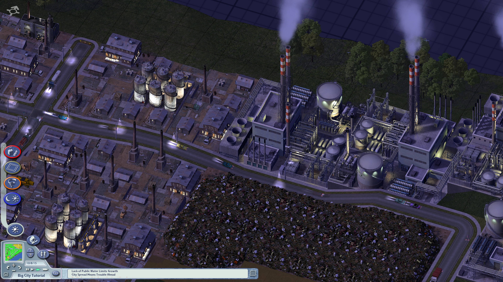

# SimCity 4 UHD

A mod for **SimCity 4 Deluxe on Windows** with 4K support, a larger interface, and upscaled textures.

## Install the mod

1. Download [SimCity4UHD-Setup.exe](https://github.com/Feverqwe/simcity4-hd/releases/latest/download/SimCity4UHD-Setup.exe), close SimCity 4, and open the installer.
2. Select **Install**. If setup cannot find the Steam installation, choose the game folder.
3. When setup finishes, select **Play** to launch **SimCity 4 Deluxe** through Steam. The mod uses your existing saves and starts at your main display’s current resolution by default.

Setup requires the original Steam build 4644414. Generating missing textures with the installer requires internet access and an NVIDIA GPU that can run the model in bfloat16 through PyTorch CUDA. On AMD, you can run the installer with a complete texture cache.

The full texture pack uses about 20 GiB, with additional space for the cache and downloads. Setup checks space before starting. You can close setup and reuse the same texture cache later.

Setup defaults to ×2 textures downscaled from ×4. Choose ×4 in **Advanced options**.

By default, setup uses the `SimCity4UHDCache` folder next to the installer EXE. To reuse a cache from another location, select its folder in **Advanced options**.

To change a mod installed through setup, close the game, reopen setup, and select **Configure**. Change the options and select **Apply changes**. Setup keeps disabled world textures available for later use. Select **Remove mod** to remove the installation and keep the texture cache.

Setup shows installation steps and errors below the progress bar. Each session is saved under `%LOCALAPPDATA%/SimCity4HD/Logs`.

See [Advanced setup](docs/advanced.md) for building textures from source and testing in a separate profile.
