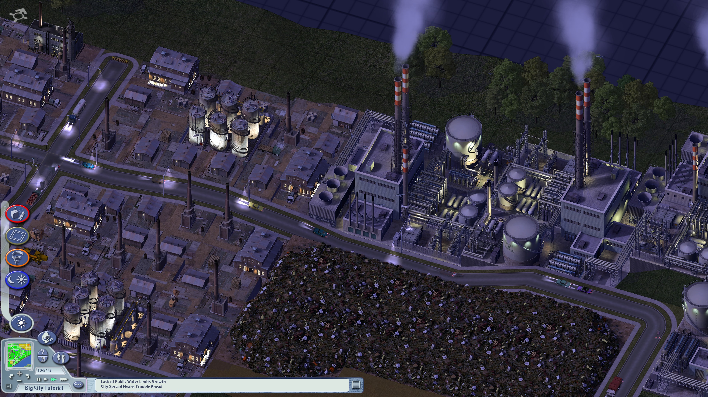

# SimCity 4 UHD

A **SimCity 4 Deluxe** mod for playing your existing cities at 4K, with a larger, more readable interface and sharper city textures. It also fixes clipped controls, uneven scaling, and crashes in parts of the enlarged interface.

## Supported platforms

| Platform | Required Steam edition | Display support |
| --- | --- | --- |
| [Windows x64](#install-on-windows) | Original SimCity 4 Deluxe 1.1.641.0 (build 4644414) | Direct3D 11 through SCD3D11. In-game display changes apply after a restart. |
| [macOS on Apple silicon](#install-on-macos) (experimental) | Aspyr SimCity 4 Deluxe 1.2.1 (build 185949), running through Rosetta | Aspyr OpenGL, live resolution and window mode changes, resizable windows, and Retina text with the HD interface. |

With the UHD interface enabled, **Graphics Options** offers a choice of resolution and windowed, fullscreen, or borderless fullscreen mode. Borderless fullscreen uses the desktop resolution.

## What the mod adds and fixes

### Textures and region view

- **×2 and ×4 texture packs** for the interface and world, built from the original game artwork. Both texture settings use the same enlarged interface layout.
- Sharper terrain, roads, rail, station and transit textures, buildings, lot surfaces, props, animations, and effects. Textures retain detail across zoom levels, including on lots with multiple animation frames.
- More detailed animated 3D advisor portraits, built from the original game assets.
- Optional larger game cursors with aligned click points, a larger interactive region map, and a larger city loading preview. City Import also gets larger folder and city icons and readable labels throughout the folder tree.

### Interface and controls

- **Larger city controls** in God, Mayor, and My Sims modes, including the build and transport menus, Disasters, simulation speed, the pager, and Help. Rendering fixes cover clipped button states, misaligned portraits, and stray strips along panel edges.
- **Readable city statistics** with larger graph labels and plots, thicker graph lines, and realigned Data Views legends. Data Views draws sharper maps with terrain and water under the overlays. Mayor Rating arrows, City Opinion Polls meters, and Data Views icons keep their outlines and transparency.
- **Enlarged budget screens** with scaled ledgers, funding sliders and markers, Ordinances and their detail dialogs, and Neighbor Deals. Figures and labels retain their size when funding changes or lists refresh. Numeric fields accept the local decimal separator.
- **Larger building and route queries** with readable text, meters and icons, plus better placement for query help, mission panels, and dialogs. On Windows, fixes address crashes when the city HUD is placed and when certain menus or building queries draw.
- **Clearer news, advisor messages, tutorials, and tooltips** with larger text, more room for wrapping, and scrollbars that stay inside their panels. Settings and Credits also scale with the interface.
- **Updated My Sims and driving controls**, including selectors, enlarged Free Drive gauges, and a scaled button to restore the collapsed driving HUD. On Windows, Free Drive also gets sharper viewport artwork.
- **Scaled Snapshot controls** with readable instructions and a capture frame that follows the selected size.
- **Fixed Audio Options playlist scrolling.** The scrollbar thumb follows the mouse wheel, the last track is reachable, and track checkboxes scale with the list.
- **Keyboard shortcut reference** in Play Options for city, region, general, and driving controls.

### Russian translation

- A Russian game translation and Cyrillic fonts are included in setup. You can switch between Russian and the game's default language.
- Long Russian labels fit buttons, budget headings, and fixed-width captions in panels such as Building Style Control and Select a Bridge. Shortened labels can show their full text on hover. The new display settings and keyboard shortcut reference are also translated.

### Setup and existing saves

- Install the enlarged interface, world textures, or both. Choose which world texture groups to build and keep playing with your existing Steam profile and saves.
- Pause a texture build and resume from the cache, or retry a failed download during setup. Reuse finished textures when changing options or installing again, or export them as a ZIP. A complete cache for the selected options lets setup skip upscaling.
- Launch through Steam from setup, choose a startup resolution, and optionally skip the intro. Setup checks for updates and shows build progress. On macOS, it can also enable the game's FPS counter. Reopen setup to change options or restore the original game while keeping the cache.

## Install on Windows

1. Download [SimCity4UHD-Setup.exe](https://github.com/Feverqwe/simcity4-hd/releases/latest/download/SimCity4UHD-Setup.exe), close SimCity 4, and open the installer.
2. Select **Install**. If setup cannot find the Steam installation, choose the game folder.
3. When setup finishes, select **Play** to launch **SimCity 4 Deluxe** through Steam. The mod uses your existing saves and starts at your main display’s current resolution by default.

Generating missing textures requires internet access and an NVIDIA GPU with CUDA and bfloat16 support.

The full texture pack uses about 20 GiB, with additional space for the cache and downloads. Setup checks space before starting. You can close setup and reuse the same texture cache later.

Setup defaults to ×2 textures downscaled from ×4. Choose ×4 in **Advanced options**.

Choose **Русский** under **Advanced options → Game language** to use the SimCity 4 UHD Russian translation. Setup selects Russian automatically on a fresh installation when the Windows interface is in Russian. To switch back, choose **Game default** in **Configure**.

By default, setup uses the `SimCity4UHDCache` folder next to the installer EXE. To reuse a cache from another location, select its folder in **Advanced options**.

After installation finishes, select **Export textures** to save the texture cache as a ZIP. On another PC, choose **More actions → Import textures** before installing. The cache includes ready-to-use world textures for the scales you have built and interface atlases. Enable **Advanced options → Keep original upscaled images for future rebuilds** if you also want to retain the original model output when generating new textures.

To change a mod installed through setup, close the game, reopen setup, and select **Configure**. Change the options and select **Apply changes**. Setup keeps disabled world textures available for later use. Select **More actions → Remove mod** to remove the installation and keep the texture cache.

Setup shows installation steps and errors below the progress bar. Session logs are normally saved under `%LOCALAPPDATA%\SimCity4HD\Logs`.

## Install on macOS

1. Download the [installer for Apple silicon](https://github.com/Feverqwe/simcity4-hd/releases/latest/download/SimCity4UHD-Setup-macos-arm64.zip) and extract it.
2. Close SimCity 4, open **SimCity 4 UHD Setup**, and select **Install**. If setup cannot find your Aspyr Steam installation, choose the game folder.
3. After installation, launch through Steam to play with your usual profile.

Generating missing textures on the Mac uses Metal and requires macOS 14 or later. You can also import a texture archive.

See the [macOS installer guide](installer/README.md#experimental-macos-setup) for texture sources, configuration, and removal.

[Advanced setup](docs/advanced.md) covers building textures from source and testing in a separate profile.

[Discord](https://discord.gg/PHmyWuBHj)
